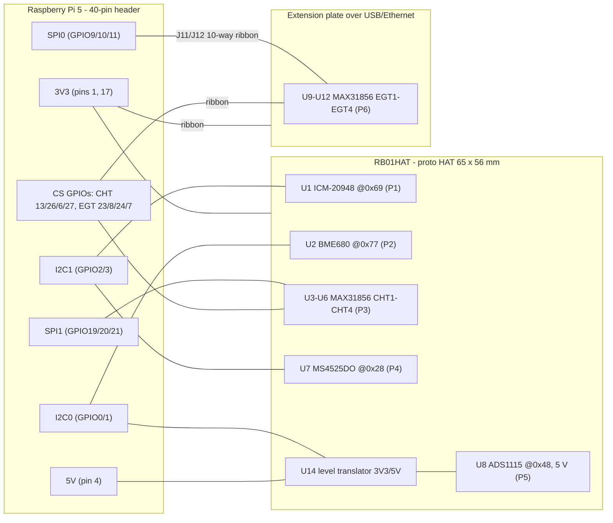

# 02 - System architecture

The pin mapping follows the RB-EMS system (rb-ems-go). Why, and what differs from its pinout image, is in
[07-rb-ems-alignment.md](07-rb-ems-alignment.md). The authoritative pin and address tables are generated:
[generated/gpio-map.md](generated/gpio-map.md). This page explains how the HAT is built around that mapping.

## Block diagram

## Buses

| Bus | Pins | Devices | Clock | Notes |
|---|---|---|---|---|
| I2C1 | GPIO2 SDA (pin 3), GPIO3 SCL (pin 5) | ICM-20948 0x69 (AK09916 at 0x0C in bypass mode), MS4525DO 0x28 | 100 kHz for bring-up, then 400 kHz | Pi has ~1.8 kOhm on-board pull-ups. RB scheme: IMU/BARO/MAG bus. If an external BARO is fitted, 0x76/0x77 must stay free here. |
| I2C0 | GPIO0 (27), GPIO1 (28) | BME680 0x77; ADS1115 0x48 behind U14; optional EEPROM 0x50 | 100 kHz (`i2c0-pi5` default) | **No Pi pull-ups**: R11/R12 3.9 kOhm on the HAT. HAT+ deviation (ID pins carry sensors). The RB image's second ADS1115 would be 0x49. |
| SPI1 | GPIO20 MOSI (38), GPIO19 MISO (35), GPIO21 SCLK (40) | CHT1-CHT4 MAX31856 | rb-ems-go `busSpeed` (1 MHz recommended) | Mode 1. CS on GPIO13/26/6/27. Kernel CE0 = GPIO18 (`spi1-1cs`) stays unconnected. GPIO17 is the RB system's 5th MAX31856 (off-HAT). |
| SPI0 | GPIO10 MOSI (19), GPIO9 MISO (21), GPIO11 SCLK (23) | EGT1-EGT4 MAX31856 (extension) | same | Mode 1. CS on GPIO23/8/24/7. `spi0-0cs` keeps the kernel off GPIO7/8. |

### I2C pull-up budget

Each I2C device must sink the pull-up current. At 3 mA and 3.3 V, the combined pull-up must stay at or above
**about 1.1 kOhm**.

- **I2C1**: Pi ~1.8 kOhm plus the IMU module's pull-ups (typically 10 kOhm) gives ~1.5 kOhm. OK. Remove extra module
  pull-ups if more modules join this bus.
- **I2C0, 3.3 V side**: R11/R12 3.9 kOhm, plus the BME680 module (~10 kOhm), plus the translator's low-side
  pull-ups (~10 kOhm on BSS138 modules) gives ~2.2 kOhm. OK.
- **I2C0, 5 V side**: translator high-side pull-ups (~10 kOhm) and the ADS1115 module's (~10 kOhm) give ~5 kOhm at
  5 V = 1 mA. OK.

### Why GPIO chip-selects (and pull-ups on them)

rb-ems-go drives every thermocouple chip-select as a GPIO ("gpio" > 0 in `ems-chtegt.json`). The HAT+ spec says GPIOs
power up with an unspecified weak pull-up *or* pull-down. A pulled-down CS would select several chips at once and
make their SDO outputs fight on MISO. So each CS has 10 kOhm to 3V3 (R1-R8). R5-R8 sit on the HAT side of the
ribbon so the EGT lines stay defined when the ribbon is unplugged.

### No interrupt or fault lines

The RB scheme assigns all 28 GPIOs. IMU INT, MAX31856 FAULT/DRDY and ADS1115 ALERT/RDY are left unconnected (see the
NC rows in the netlist). Software polls: the MAX31856 status register (0x0F) reports open, over/under-voltage and
range faults per channel, and rb-ems-go already reads data this way.

### Why the ADS1115 runs at 5 V

`ems-adc.json` reads 0-5 V signals at `gain_mv` 6144 with `r0` = 1 (including the 5 V rail itself, "rail50"). That
only works with ADS1115 VDD = 5 V, because inputs must stay at or below VDD + 0.3 V. U14 translates I2C0 between
3.3 V and 5 V. A BSS138 or PCA9306 translator isolates when the Pi's 3V3 is off, so STANDBY can't back-power
GPIO0/1. Details and the 3.3 V alternative are in [07-rb-ems-alignment.md](07-rb-ems-alignment.md#ads1115-supply-5-v-behind-a-level-translator).

## Power

| Rail | From | Loads |
|---|---|---|
| 3V3 | Pi pins 1 + 17, with C1 22 uF + C2 100 nF at the entry | U1, U2, U3-U6, U7 (+ C3), U9-U12, U14 low side, R1-R8, R11/R12 |
| 5V | Pi pin 4 | U8 ADS1115, U14 high side |

In STANDBY the Pi switches 3V3 off and keeps 5V on. Only U8 and U14's high side stay powered, and U14 isolates them
from the GPIOs.

| Load | Typical | Max | Source |
|---|---|---|---|
| ICM-20948 + module regulator | ~3 mA | ~4 mA | TDK datasheet |
| BME680 | <1 mA | ~12 mA during the gas-heater phase | Bosch datasheet (heater phase) |
| MAX31856 x8 | 8 x 1.2 mA | 8 x 2 mA | ADI/Maxim datasheet |
| MS4525DO | ~3 mA | ~3 mA | estimate: the TE datasheet gives no supply current |
| ADS1115 (5 V rail) | 0.15 mA | 0.3 mA | TI datasheet |
| **Total 3V3** | **~17 mA** | **~36 mA** | |
| Module power LEDs (if left fitted) | 1-5 mA each | up to ~60 mA | Remove them. They also heat the sensors. |

The Pi 5's spare 3V3 capacity on the header is not officially published (older boards are usually quoted at about
500 mA shared with on-board loads). Keep the HAT under 200 mA. This design uses less than 50 mA.

## Software architecture

- **Production**: rb-ems-go (Go, periph.io) reads the thermocouples and the ADS1115 using the same pins and buses.
  `make rbems` checks the HAT against its JSON configs.
- **Bring-up**: [software/bringup/rb01hat_bringup.py](../software/bringup/rb01hat_bringup.py) (Python, `smbus2`,
  `spidev`, `gpiozero`) verifies every connection and reads its pin map from the CSVs.
- **Possible later**: kernel IIO drivers through an overlay. This only makes sense if rb-ems-go moves to IIO; see
  [06-custom-pcb.md](06-custom-pcb.md).

## Addresses to avoid when adding I2C devices

| Bus | Taken | Keep free |
|---|---|---|
| I2C1 | 0x0C (AK09916 bypass), 0x28, 0x69 | 0x68 (IMU alternate), 0x76/0x77 (an RB BARO), 0x36/0x46 (MS4525DO alternates) |
| I2C0 | 0x48, 0x77, 0x50 (EEPROM, DNP) | 0x49 (RB second ADS1115), 0x4A/0x4B, 0x76 (BME680 alternate) |

`make check` rejects duplicate addresses among the parts in `parts.csv`.
