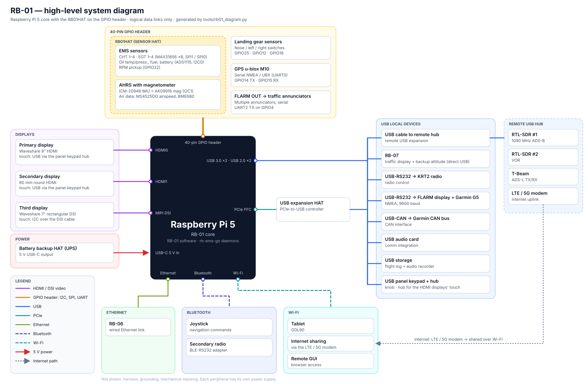

# 08 - RB-01 system overview

High-level view of the RB-01 unit built around the Raspberry Pi 5, showing where the RB01HAT fits.

The diagram is generated: edit the component lists in [tools/rb01_diagram.py](../tools/rb01_diagram.py), then run
`make docs`.

## Interfaces

| Component | Link | Pi 5 side | Notes |
|---|---|---|---|
| Primary display, Waveshare 8″ | HDMI | HDMI0 (micro-HDMI) | Touch over USB, through the panel keypad hub |
| Secondary display, 80 mm round | HDMI | HDMI1 (micro-HDMI) | Touch over USB, through the panel keypad hub |
| Third display, Waveshare 7″ rectangular | MIPI DSI | CAM/DISP FFC | Touch over I2C on the DSI cable |
| EMS sensors: CHT 1-4, EGT 1-4, oil, fuel, battery, RPM | 40-pin header, via the RB01HAT | SPI1, SPI0, I2C0, GPIO22 | [generated/gpio-map.md](generated/gpio-map.md) |
| AHRS with magnetometer (ICM-20948 + AK09916), air data | 40-pin header, via the RB01HAT | I2C1 (BME680 on I2C0) | |
| Landing gear sensors (nose, left, right) | GPIO | GPIO25, GPIO12, GPIO16 | rb-ems-go `ems-gpio.json` |
| GPS u-blox M10 | serial | UART0, GPIO14/15 | |
| Traffic annunciators (several) | serial, FLARM OUT | UART2 TX, GPIO4 | Separate from the USB-RS232 feed to the FLARM display + G5 |
| Battery backup HAT (UPS) | 5 V power | USB-C input | |
| USB expansion HAT | PCIe | PCIe FFC | Extra USB ports for the local devices |
| USB local devices (8) | USB | Native ports (2x USB 3.0, 2x USB 2.0) + expansion HAT | Storage, audio card, RB-07, 2x USB-RS232 (KRT2; FLARM display + G5 at 9600 baud), USB-CAN (Garmin CAN), keypad, remote hub link |
| USB panel keypad with knob | USB | Local USB | Also a USB hub: carries the touch of both HDMI displays |
| Remote USB hub | USB cable | One local USB port | 2x RTL-SDR (1090 MHz ADS-B, VOR), T-Beam ADS-L TX/RX, LTE/5G modem |
| RB-06 | Ethernet | RJ45 | |
| Joystick, secondary radio (BLE-RS232) | Bluetooth | On-board radio | |
| Tablet (GDL90), internet sharing, remote GUI | Wi-Fi | On-board radio | Internet comes from the LTE/5G modem on the remote hub |

## Decisions (2026-10-12)

- **Power**: every peripheral has its own power supply, so the Pi 5 USB current limit doesn't constrain the design.
- **Touch**: the HDMI displays' USB touch goes through the panel keypad, which is also a USB hub. The DSI display's
  touch uses I2C on the DSI cable. 8 local USB devices on 4 native ports means the expansion HAT provides at least
  4 more.
- **Traffic**: FLARM OUT on GPIO4 (UART2) is still used, for several traffic annunciators. The USB-RS232 adapter
  separately feeds the FLARM display and the Garmin G5.

## Open

- **Mechanical stack**: the battery-backup HAT, the PCIe USB HAT and the RB01HAT (40-pin header, ~20 mm stack,
  extension plate over USB/Ethernet; see [03-mechanical.md](03-mechanical.md)) all need a place around the Pi.
  To be checked against the STL models once imported.
